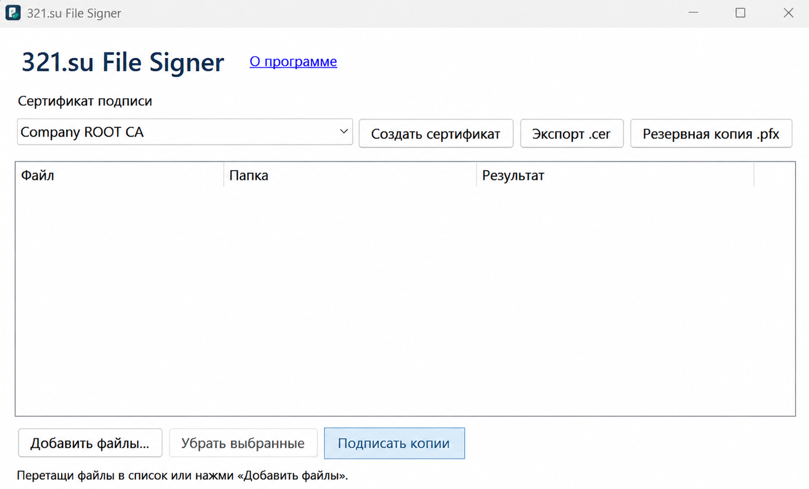

# 321.su File Signer

[English](#english) · [Русский](#русский)

## English

Create a **code signing certificate** and sign PowerShell scripts, Windows programs, or RDP files. File Signer uses your Windows certificate store, signs files in batches, and saves copies alongside the originals with the `-signed` suffix.

[321.su website](https://321.su) · [Sign with PowerShell](#sign-with-powershell) · [Deploy trust with Group Policy](#deploy-trust-with-group-policy) · [Release a signed EXE](docs/RELEASE.md)



*The screenshot shows an earlier version of the interface with a sample certificate name.*

### Sign files in the app

1. Select an existing signing certificate or choose **Create certificate**. Set its validity in days. The default is 10 calendar years.
2. Add files or drag them into the window, then choose **Sign copies**.
3. Use **Export .cer** to export the public certificate for Group Policy deployment. **Back up .pfx** saves the certificate and private key in a password-protected file if the key is exportable.

Authenticode signing supports PS1, PSM1, PSD1, EXE, DLL, MSI, CAB, and CAT files. RDP signing uses Windows’ `rdpsign.exe` utility. For a C# project, build it first and sign the compiled EXE, DLL, or installer.

### Where to create the certificate

For internal signing, use a dedicated Windows 11 workstation. Create the key under the account that will sign files. Deploy the public **CER** to servers and other target machines. Keep the private key and its PFX backup with the publisher.

Windows Server supports creating code signing certificates. Errors can occur when importing a PFX, accessing the private key, or verifying a signature. Use the symptom below to narrow down the cause.

| Symptom | What to check |
|---|---|
| The certificate is visible, but signing is unavailable | A CER contains the public certificate. The signing account needs the private key in its Personal certificate store. Check `HasPrivateKey` and confirm the account can access the key. |
| Windows Server 2016 rejects a PFX despite the correct password | Older Windows versions can reject PFX files protected with AES256-SHA256. If a transfer to an older machine is required, Microsoft documents exporting the PFX with TripleDES-SHA1 for compatibility. |
| The script is signed, but PowerShell reports an untrusted publisher | Check the certificate chain on the target machine and confirm that the signing certificate is in **Trusted Publishers**. |

[Importing PFX files on Windows Server](https://learn.microsoft.com/en-us/troubleshoot/windows-server/certificates-and-public-key-infrastructure-pki/cannot-import-aes256-sha256-encrypted-pfx-certificate) · [Signing PowerShell scripts](https://learn.microsoft.com/en-us/powershell/module/microsoft.powershell.core/about/about_signing)

### Deploy trust with Group Policy

In **Group Policy Management**, create a GPO and link it to the OU containing the target computers. Open **Computer Configuration → Policies → Windows Settings → Security Settings → Public Key Policies**.

- **Self-signed File Signer certificate.** Import the public CER into **Trusted Root Certification Authorities** and **Trusted Publishers**.
- **Certificate issued by an enterprise CA.** Import the signing certificate into **Trusted Publishers**. If the target PCs do not already trust the CA chain, deploy the root and any required intermediate certificates to their corresponding stores.

On a test PC, refresh Group Policy and check the signature.

```powershell
gpupdate /target:computer /force
Get-AuthenticodeSignature -LiteralPath '.\MyScript-signed.ps1' |
    Format-List Status, StatusMessage, SignerCertificate
```

The expected status is `Valid`. Group Policy trust applies to managed computers. For public downloads, Windows also checks SmartScreen reputation.

[Deploy certificates using Group Policy](https://learn.microsoft.com/en-us/windows-server/identity/ad-cs/distribute-certificates-group-policy) · [Configure Trusted Publishers](https://learn.microsoft.com/en-us/microsoft-365-apps/security/trusted-publisher) · [SmartScreen for developers](https://learn.microsoft.com/windows/apps/package-and-deploy/smartscreen-reputation)

### What the program does is simply provide a user-friendly interface—an alternative to the PowerShell scripts below:

Run these commands in Windows PowerShell 5.1. Create the certificate once and select it by thumbprint each time you sign.

**Create a certificate and export the public CER**

```powershell
$cert = New-SelfSignedCertificate -Type CodeSigningCert `
    -Subject 'CN=Company Code Signing' -CertStoreLocation 'Cert:\CurrentUser\My' `
    -KeyAlgorithm RSA -KeyLength 2048 -HashAlgorithm SHA256 `
    -KeyExportPolicy Exportable -NotAfter (Get-Date).AddYears(10)

$cert | Format-List Subject, Thumbprint, HasPrivateKey, NotAfter
Export-Certificate -Cert $cert -FilePath '.\Company-CodeSigning.cer'
```

**Sign a copy of a script or compiled EXE**

```powershell
$thumbprint = ('PASTE_THUMBPRINT' -replace '\s', '')
$cert = Get-Item -LiteralPath "Cert:\CurrentUser\My\$thumbprint" -ErrorAction Stop
if (-not $cert.HasPrivateKey) { throw 'The private key is unavailable.' }

$source = '.\MyScript.ps1' # For a Windows program, use the path to the compiled EXE.
$file = Get-Item -LiteralPath $source -ErrorAction Stop
$copy = Join-Path $file.DirectoryName ($file.BaseName + '-signed' + $file.Extension)
[IO.File]::Copy($file.FullName, $copy, $false)
Set-AuthenticodeSignature -LiteralPath $copy -Certificate $cert -HashAlgorithm SHA256 |
    Format-List Status, StatusMessage
```

**Back up the certificate and private key**

```powershell
$password = Read-Host 'Backup password' -AsSecureString
if ($password.Length -eq 0) { throw 'Enter a nonempty password.' }
Export-PfxCertificate -Cert $cert -FilePath '.\Company-CodeSigning.pfx' `
    -Password $password -NoClobber
```

You can deploy the CER with Group Policy. Keep the PFX and its password outside the repository.

[New-SelfSignedCertificate](https://learn.microsoft.com/en-us/powershell/module/pki/new-selfsignedcertificate) · [Set-AuthenticodeSignature](https://learn.microsoft.com/en-us/powershell/module/microsoft.powershell.security/set-authenticodesignature) · [Export-PfxCertificate](https://learn.microsoft.com/en-us/powershell/module/pki/export-pfxcertificate)

### Build

On Windows with MSBuild and the .NET Framework 4.8 Developer Pack, run `publish.bat`. The executable is saved to `publish\FileSigner321.exe` and build details go to `publish.log`. The app requires .NET Framework 4.8 or 4.8.1. It opens in Russian. Use **RU** and **EN** at the bottom of the window to switch languages without restarting.

If the window closes after you double-click the batch file, open Command Prompt in the extracted folder and run `cmd /d /k call publish.bat` to keep diagnostics visible.

---

## Русский

Создай сертификат **Code Signing** и подпиши свой PowerShell-скрипт, готовую программу или RDP-файл. File Signer берёт сертификат из хранилища Windows, подписывает файлы пакетно и сохраняет копии рядом с исходниками с суффиксом `-signed`.

[Сайт 321.su](https://321.su) · [Подпись через PowerShell](#подпись-через-powershell) · [Доверие через GPO](#доверие-через-gpo) · [Выпуск подписанного EXE](docs/RELEASE.md)


*На скриншоте показана предыдущая версия окна с демонстрационным именем сертификата.*

### Подпись через интерфейс

1. Выбери существующий сертификат подписи или нажми **«Создать сертификат»**. Срок задаётся в днях, по умолчанию — 10 календарных лет.
2. Добавь файлы или перетащи их в окно и нажми **«Подписать копии»**.
3. Нажми **«Экспорт .cer»**, чтобы получить публичный сертификат для распространения через GPO. **«Резервная копия .pfx»** сохраняет с паролем сертификат и закрытый ключ, если ключ допускает экспорт.

Поддерживаются PS1, PSM1, PSD1, EXE, DLL, MSI, CAB и CAT через Authenticode. Для RDP используется системная утилита `rdpsign.exe`. Исходный C#-код сначала собирается, затем подписывается готовый EXE, DLL или установщик.

### Где создавать сертификат

Для внутренней подписи создавай ключ на выделенной рабочей станции с Windows 11 под учётной записью, которой будешь подписывать файлы. Серверы и другие целевые машины получают публичный **CER**. Закрытый ключ и резервная копия PFX остаются у издателя.

Windows Server поддерживает создание сертификатов для подписи кода. При импорте PFX, доступе к закрытому ключу или проверке подписи могут возникать ошибки. Если сертификат кажется «битым», ищи причину по конкретному симптому из таблицы ниже.

| Симптом | Что проверить |
|---|---|
| Сертификат виден, но подпись недоступна | CER содержит только публичную часть. На машине подписи нужен закрытый ключ в личном хранилище учётной записи, которая выполняет подпись. Посмотри `HasPrivateKey` и проверь доступ к ключу. |
| Windows Server 2016 отвергает PFX с верным паролем | Microsoft документирует несовместимость импорта PFX с AES256-SHA256 в старых версиях. Это проблема формата контейнера, а не повреждение сертификата. При необходимости переноса ключа на совместимую старую машину Microsoft описывает экспорт PFX в TripleDES-SHA1. |
| Скрипт подписан, но PowerShell сообщает о недоверенном издателе | Проверь цепочку на целевой машине и наличие сертификата издателя в **Trusted Publishers**. |

[Импорт PFX в Windows Server](https://learn.microsoft.com/en-us/troubleshoot/windows-server/certificates-and-public-key-infrastructure-pki/cannot-import-aes256-sha256-encrypted-pfx-certificate) · [Подпись PowerShell-скриптов](https://learn.microsoft.com/en-us/powershell/module/microsoft.powershell.core/about/about_signing)

### Доверие через GPO

В **Group Policy Management** создай GPO и привяжи её к OU целевых компьютеров. Открой **Конфигурация компьютера → Политики → Конфигурация Windows → Параметры безопасности → Политики открытого ключа**.

- **Самоподписанный сертификат File Signer.** Импортируй его публичный CER в **«Доверенные корневые центры сертификации»** и **«Доверенные издатели»**.
- **Сертификат от корпоративного УЦ.** Импортируй CER подписанта в **«Доверенные издатели»**. Если на целевых ПК ещё нет доверия к цепочке УЦ, распространи корневой и при необходимости промежуточный сертификаты по соответствующим хранилищам.

На тестовом ПК обнови политику и проверь подпись.

```powershell
gpupdate /target:computer /force
Get-AuthenticodeSignature -LiteralPath '.\MyScript-signed.ps1' |
    Format-List Status, StatusMessage, SignerCertificate
```

Ожидаемый статус — `Valid`. Доменное доверие действует на управляемых ПК. Для публичных загрузок Windows отдельно оценивает репутацию SmartScreen.

[Распространение сертификатов через GPO](https://learn.microsoft.com/en-us/windows-server/identity/ad-cs/distribute-certificates-group-policy) · [Настройка Trusted Publishers](https://learn.microsoft.com/en-us/microsoft-365-apps/security/trusted-publisher) · [SmartScreen для разработчиков](https://learn.microsoft.com/windows/apps/package-and-deploy/smartscreen-reputation)

### Что делает программа это просто удобный интерфейс - как альтернатива PowerShell скриптам ниже: 

Команды для Windows PowerShell 5.1 можно выполнить напрямую. Создание сертификата нужно выполнить один раз. Для последующих подписей выбирай его **по отпечатку**.

**Создать сертификат и экспортировать публичный CER**

```powershell
$cert = New-SelfSignedCertificate -Type CodeSigningCert `
    -Subject 'CN=Company Code Signing' -CertStoreLocation 'Cert:\CurrentUser\My' `
    -KeyAlgorithm RSA -KeyLength 2048 -HashAlgorithm SHA256 `
    -KeyExportPolicy Exportable -NotAfter (Get-Date).AddYears(10)

$cert | Format-List Subject, Thumbprint, HasPrivateKey, NotAfter
Export-Certificate -Cert $cert -FilePath '.\Company-CodeSigning.cer'
```

**Подписать копию скрипта или готового EXE**

```powershell
$thumbprint = ('ВСТАВЬ_ОТПЕЧАТОК' -replace '\s', '')
$cert = Get-Item -LiteralPath "Cert:\CurrentUser\My\$thumbprint" -ErrorAction Stop
if (-not $cert.HasPrivateKey) { throw 'Закрытый ключ недоступен.' }

$source = '.\MyScript.ps1' # Для программы укажи путь к собранному EXE.
$file = Get-Item -LiteralPath $source -ErrorAction Stop
$copy = Join-Path $file.DirectoryName ($file.BaseName + '-signed' + $file.Extension)
[IO.File]::Copy($file.FullName, $copy, $false)
Set-AuthenticodeSignature -LiteralPath $copy -Certificate $cert -HashAlgorithm SHA256 |
    Format-List Status, StatusMessage
```

**Сохранить резервную копию с закрытым ключом**

```powershell
$password = Read-Host 'Пароль резервной копии' -AsSecureString
if ($password.Length -eq 0) { throw 'Укажи непустой пароль.' }
Export-PfxCertificate -Cert $cert -FilePath '.\Company-CodeSigning.pfx' `
    -Password $password -NoClobber
```

CER можно распространять через GPO. PFX и пароль храни отдельно от репозитория.

[New-SelfSignedCertificate](https://learn.microsoft.com/en-us/powershell/module/pki/new-selfsignedcertificate) · [Set-AuthenticodeSignature](https://learn.microsoft.com/en-us/powershell/module/microsoft.powershell.security/set-authenticodesignature) · [Export-PfxCertificate](https://learn.microsoft.com/en-us/powershell/module/pki/export-pfxcertificate)

### Сборка

На Windows с MSBuild и .NET Framework 4.8 Developer Pack запусти `publish.bat`. Результат появится в `publish\FileSigner321.exe`, подробности сборки — в `publish.log`. Для запуска нужен .NET Framework 4.8 или 4.8.1. Язык меняется кнопками **RU** и **EN** внизу окна.

Если окно закрывается при запуске двойным щелчком, открой командную строку в распакованной папке и выполни `cmd /d /k call publish.bat`. Команда оставит окно открытым для диагностики.

© 2026 321.su · [Сайт разработчика](https://321.su)
